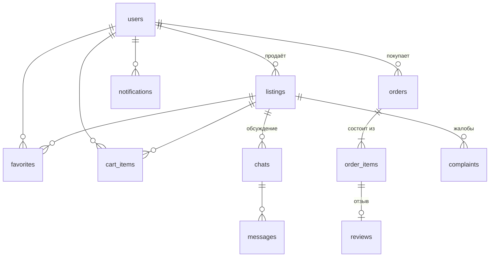

# Русский ресейл

Курсовой проект: Android-приложение (Java) — площадка в стиле Авито для покупки и продажи **только одежды, обуви и аксессуаров**: винтаж, ресейл и вещи, которые ателье шьёт по меркам покупателя.

**Стек:** Java 17, Android SDK (minSdk 26, targetSdk 35, compileSdk 36), Material Design 3, ViewBinding, Room (SQLite), LiveData + ViewModel, Glide. Сборка — Gradle 9.6 (Kotlin DSL, version catalog), AGP 9.3.

## Роли

Роль выбирается при регистрации и потом не меняется.

| Возможность | Покупатель | Продавец (ателье, магазин) | Администратор |
|---|:-:|:-:|:-:|
| Каталог, поиск, фильтры | ✅ | просмотр | просмотр |
| Избранное, корзина, покупка | ✅ | ❌ | ❌ |
| Размещение и редактирование объявлений | ❌ | ✅ | ❌ |
| Обработка заказов (принять, отправить, отменить) | — | ✅ свои | — |
| Отзывы (1–5 ★) после получения заказа | ✅ пишет | ✅ отвечает | — |
| Сообщения | ✅ начинает чат | ✅ отвечает | — |
| Жалобы на объявления | ✅ | ✅ | ✅ рассматривает |
| Блокировка объявлений и пользователей | — | — | ✅ |

Ограничения проверяются дважды: в интерфейсе (кнопок «Купить» у продавца и «Новое объявление» у покупателя просто нет) и в репозиториях, как на сервере: `requireBuyer()` / `requireSeller()` / `requireAdmin()` в `BaseRepository`. Даже если вызвать покупку от имени продавца в обход интерфейса, операция будет отклонена.

## Возможности

- **Каталог:** поиск по названию, бренду, цвету, материалу и описанию; 11 категорий (верхняя одежда, платья и юбки, футболки, брюки, костюмы, трикотаж, обувь, сумки, головные уборы, украшения, аксессуары); фильтры по полу, состоянию, размеру, цене и типу «готовая вещь / пошив на заказ»; сортировка.
- **Объявление:** галерея до 8 фото (выбор из галереи, копируются во внутреннюю память), характеристики, состояние, количество, режим «пошив на заказ» со сроком изготовления, счётчики просмотров и «в избранном», отзывы о вещи, карточка продавца.
- **Заказ:** корзина с товарами нескольких продавцов (делится на отдельные заказы), «Купить сейчас», доставка (самовывоз, СДЭК, Почта, курьер; бесплатно от 7 000 ₽), оплата картой (имитация, проверка номера по алгоритму Луна), СБП или при получении, мерки для вещей на заказ. Остатки списываются при заказе и возвращаются при отмене.
- **Статусы заказа:** ждёт подтверждения → принят продавцом → отправлен (с трек-номером) → получен покупателем; отмена покупателем до подтверждения или продавцом до отправки с указанием причины.
- **Отзывы:** один отзыв на каждую вещь полученного заказа, публичный ответ продавца, средний рейтинг продавца.
- **Сообщения** покупателя и продавца по конкретной вещи со счётчиками непрочитанного.
- **Уведомления** о заказах, отзывах, жалобах и модерации.
- **Профиль продавца** (публичный): описание ателье, рейтинг, вещи в продаже, отзывы. Статистика продаж: новые заказы, выручка, комиссия площадки.
- **Администратор:** жалобы, все объявления, пользователи, статистика площадки.
- Светлая и тёмная тема.

## Запуск

1. Откройте папку проекта в Android Studio (**File → Open**) и дождитесь Gradle Sync.
2. Запустите конфигурацию `app` на эмуляторе или телефоне с Android 8.0+.

Сервер не нужен: данные хранятся в локальной базе SQLite (Room). При первом запуске база заполняется демо-данными: 3 продавца, ~24 объявления, заказы во всех статусах, отзывы, переписка и жалобы.

Демо-аккаунты (на экране входа есть кнопки автозаполнения), пароль у всех `123456`:

| Роль | Email |
|---|---|
| Покупатель | `buyer@resale.ru` (ещё один — `buyer2@resale.ru`) |
| Продавец — Ателье «Нить» | `seller@resale.ru` |
| Продавец — Vintage Room | `seller2@resale.ru` |
| Продавец — Мастерская «Бусина» | `seller3@resale.ru` |
| Администратор | `admin@resale.ru` |

Чтобы вернуть демо-данные к исходному виду, удалите приложение с устройства или очистите его данные.

## Архитектура

```
app/src/main/java/com/russianresale/app
├── App.java                 — Application и контейнер зависимостей
├── data
│   ├── entity/              — таблицы Room: User, Listing, Favorite, CartItem, Order, OrderItem,
│   │                          Review, Chat, Message, AppNotification, Complaint
│   ├── dao/                 — запросы к БД (LiveData для автообновления экранов)
│   ├── db/AppDatabase.java  — база данных Room
│   ├── model/               — перечисления (роли, категории, статусы) и результаты запросов
│   ├── repo/                — бизнес-логика и проверка прав (аналог серверного API)
│   ├── SessionManager.java  — текущий пользователь
│   └── DemoSeeder.java      — демо-данные
├── ui                       — экраны: auth, main, catalog, listing, cart, orders, seller,
│                              chat, notifications, profile, admin, common
└── util                     — валидация, хеширование паролей, цены, форматирование, фото
```

- Экраны (Activity/Fragment) подписываются на `LiveData` из репозиториев: изменения в базе сразу отражаются в интерфейсе.
- Все изменения выполняются в одном фоновом потоке и в транзакции (`BaseRepository.exec`), результат возвращается в главный поток через `Callback`.
- Пароли хранятся как SHA-256 с солью.
- Каталог фильтруется SQL-запросом, который собирает `ListingFilter` (`@RawQuery`).

### База данных



Схема Room выгружается при сборке в `app/schemas`.

## Тесты

Unit-тесты бизнес-правил (`app/src/test`): валидация, хеширование паролей, переходы статусов заказа, расчёт доставки, форматирование, сборка SQL-фильтра каталога.

```bash
./gradlew testDebugUnitTest
```

## Сборка в GitHub Actions

- **Build APK** (`.github/workflows/build.yml`) — на каждый push: unit-тесты и debug-APK в разделе Artifacts.
- **Release** (`.github/workflows/release.yml`) — по тегу `v*` или вручную (Actions → Release → Run workflow): APK и ZIP с исходным кодом публикуются в Releases.
